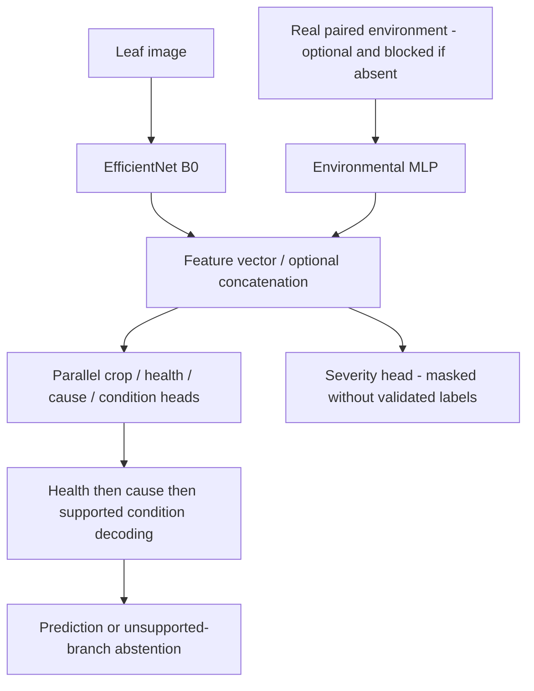

# Manuscript revision guide

Original manuscript and evaluation PDF absent. This is a section guide, not claimed line-level revision.
Suggested provisional title: "Evaluating Source Bias in Image-Based Tomato Disease and Nutrient-Deficiency Diagnosis".
Use it only after the tomato deficiency evaluation actually runs. Present code currently covers eight crops; a
tomato-only publication must explicitly select/verify the tomato cohort and document that scope.

- Abstract: state measured scope, dataset provenance and limitations. No planned results as actual; do not cite
  trivial one-class cause accuracy as disease/deficiency discrimination. Current new experiment results are BLOCKED.
- Introduction: focus on image diagnosis/source bias; remove unsupported drought/waterlogging, deployment and
  environmental causation claims. State deficiencies only if validated data are included.
- Related Work: distinguish EfficientNet transfer learning, multi-task heads and conditional inference from novel
  algorithm claims. Verify every reference's title/authors/year/DOI against supplied bibliography; unavailable here.
- Methodology: show the actual shared-backbone parallel-head architecture. Cause-first is conditional decoding,
  not a newly implemented cascade of separately trained feature extractors. Explain flat CE comparison, abstention,
  masked unsupported heads, losses, condition metadata and train-only weights. State uncalibrated confidence.
- Dataset/Experimental Setup: report actual audited counts by source/cause/condition/environment/split, independent
  groups, labels/provenance/licensing, duplicate checks, label verification and missing cells. Do not substitute
  historical eight-crop counts for the planned tomato-only 18,160/544 design. Document common-condition source
  probes and identical-cohort reviewed-mask intervention with their limitations.
- Expected Results: rename Results only after execution. Replace plans with real seed/run/checkpoint/input digests,
  per-stage/per-class metrics, support, confusion matrices and group intervals. Keep blocked rows explicitly blocked.
  Compare flat/hierarchical, image/environment/fusion only where data eligibility permits; separate historical tables.
- Discussion: report source/capture confounding, test intervention vs retraining, source overlap, lab-to-field support,
  annotation uncertainty, missing sensors and true generalization limits. Explainability is not expert validation.
- Conclusion: restrict claims to executed evidence. Do not claim publication-ready or field-ready performance.
- References: reconcile in-text and bibliography entries, dataset papers and licenses; no invented citations/DOIs.

Architecture figure source (render/insert only when preparing the actual manuscript):

Add representative independently verified dataset images (permission/license checked), clear table headings,
units/support/CI definitions, and distinguish legacy heuristic severity from ground truth. No real dataset images
are available here for selection. Add author names, actual affiliations, correspondence, contributions, funding,
conflicts of interest, ethics/consent applicability, data/code availability and target-venue declarations only after
authors provide the facts. Code URL: investigator fork/branch; dataset availability must follow actual licenses.
